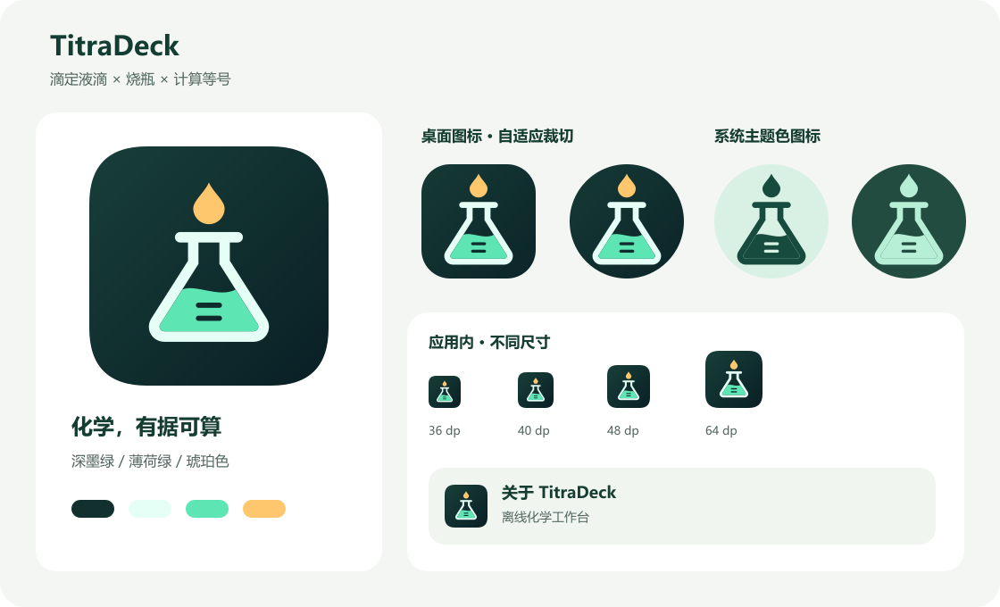

# TitraDeck 图标

原创矢量图标以「滴定液滴 × 烧瓶 × 计算等号」表达化学计算。深墨绿渐变底、薄荷绿溶液和琥珀色液滴与应用的化学工作台定位对应；图形不依赖字母，在小尺寸下保留轮廓辨识度。

## 已接入的位置

- 桌面启动图标与圆形图标：同一 adaptive icon，前景保持在中央 66 dp 安全圆内。
- Android 13+ 系统主题图标：独立单色透明蒙版，由支持的启动器根据系统主题色着色；需要用户在启动器中开启主题图标。
- 启动画面：Android 12+ 使用系统原生启动图标，Android 8–11 使用居中品牌图标；亮暗底色及系统栏图标跟随系统模式，不增加人工等待。
- 首页标题前 36 dp、关于页 48 dp、宽屏导航栏顶部 40 dp：统一的 `AppBrandIcon` 组件，保留品牌色，邻接文字处不重复播报。

## 文件

| 文件 | 用途 |
| --- | --- |
| [titradeck-icon.svg](titradeck-icon.svg) | 可编辑、可无损缩放的完整品牌图标 |
| [titradeck-icon-1024.png](titradeck-icon-1024.png) | 1024 × 1024 透明圆角图标，用于分享或设计材料 |
| [titradeck-icon-256.png](titradeck-icon-256.png) | 小尺寸预览 |
| [titradeck-monochrome.svg](titradeck-monochrome.svg) | 单色前景，空白与等号孔洞保持透明 |
| [icon-preview.svg](icon-preview.svg) | 矢量设计预览板；这是图稿预览，并非设备截图 |

应用实际使用 `app/src/main/res/drawable/` 中的 VectorDrawable，不加载这些 PNG。`ic_launcher_foreground.xml` 与 `ic_launcher_monochrome.xml` 使用相同路径；`ic_brand_logo.xml` 的图形留白按应用内尺寸做光学校正。启动器前景有 0.94 中心缩放，应用内图形有 1.18 中心缩放。

修改 Android 矢量后，可以在项目目录运行 `python scripts/export-brand.py` 重新导出 SVG。脚本仅使用 Python 标准库；PNG 为相应 SVG 的渲染导出，图稿变更后应同步重新导出 PNG。
